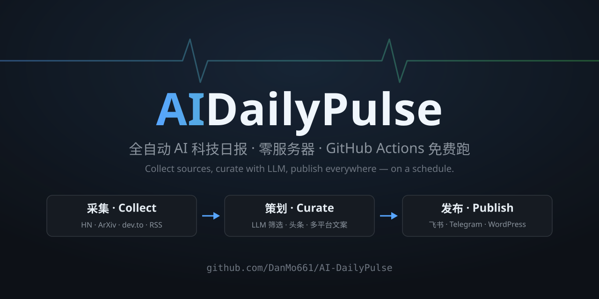

<div align="center">
  

  [](https://github.com/DanMo661/AI-DailyPulse/actions/workflows/daily-digest.yml)
  [](https://www.python.org/)
  [](LICENSE)

  **全自动 AI 科技日报** —— 一天 4 批采集攒新闻池（AIHOT / 量子位 / HN / ArXiv / TechCrunch / The Verge 等 12 源），
  每天早上 **8 点准时**把 LLM 策划的一期早报推到飞书，并生成公众号 / 小红书 / 知乎 / 抖音文案。

  Fork + 填几个 Secret，GitHub Actions 免费跑，**零服务器**。

  [简体中文](./README.md) | [English](./README_EN.md)
</div>

---

## 它每天做什么

一天 4 批采集、只攒池不推送；最后一批汇总挑选后出刊（北京时间）：

| 时间 | 做什么 | 触发方式 |
|---|---|---|
| 14:00 | 📡 采集批次 1：每源轮询选 10 篇入池，去重不推送 | GitHub Actions cron |
| 20:00 | 📡 采集批次 2 | GitHub Actions cron |
| 02:00 | 📡 采集批次 3 | GitHub Actions cron |
| **07:50** | 📡 批次 4 → 🔍 池内 ~40 篇 LLM 并行筛选 → 📝 主编定稿（**1 头条 200 字 + 4 重点 100 字左右**）→ 🖼️ 抓头条 og:image 封面 → 🚀 **推飞书** → 🗄️ 归档 | 三班错峰拉起（05:30/06:00/06:30）+ runner 内等待，首班准点执行 |
| 08:20 | 兜底重试：今日已出刊则直接跳过，绝不双推 | GitHub Actions cron |

采集覆盖 AIHOT（卡兹克 925 信源 LLM 精选，官方 API）、量子位、HN、ArXiv、TechCrunch、Simon Willison、The Verge、Ars Technica、MIT Tech Review 等，按源轮询取样防单源刷屏。

护栏：单篇筛选的 LLM 调用失败率 ≥ 50% 时当期自动中止（宁可不出刊，不推半成品）；抓不到封面不阻塞流程；飞书发送失败自动保留新闻池，08:20 兜底重试。

## 效果预览（真实产出，非摆拍）

> ### 黄仁勋退出英伟达，董事会决定不恢复CEO职务
>
> 英伟达创始人黄仁勋的离开仍在发酵。TechCrunch 报道，该公司私人投资组合在九个月内接近翻三倍，膨胀至约 650 亿美元；代理 CEO Colette Kress 则表示，董事会不会恢复黄仁勋的 CEO 职务，此前董事会已一致接受其辞职，无意让其复任。创始人离场后，英伟达这些年重金押注的初创企业网络何去何从、未来投资交易能否延续，成为市场和投资人密切关注的焦点……
>
> **📌 其他重点**
> 1. **Copilot 成"新工作 OS"，Office 应用全面入驻**
>
>    微软 Ignite 大会上将 Copilot 定义为"新的工作操作系统"，Word、Excel、PowerPoint 已可直接在 Copilot 内运行，并计划推出常驻型 AI 代理。办公入口正从传统应用转向 AI 原生工作台，竞争格局或随之改变。
>
>    原文链接：https://arstechnica.com/gadgets/2026/11/microsoft-calls-copilot-the-new-os-for-work-at-ignite-keynote/
>
> *（节选，完整一期及配套多平台文案见 [docs/example_digest.md](docs/example_digest.md)，均为真实产出）*

文字与链接分两段、无任何 AI 标注，直接复制粘贴即可发布；配套的小红书 / 知乎 / 抖音文案与公众号排版 HTML 每期自动生成。

## 5 分钟上手

```bash
# 没有服务器要求——你只需要一个 GitHub 账号和一个 LLM API Key
```

1. **Fork 本仓库**
2. 进入你自己 fork 的 **Settings → Secrets and variables → Actions**，添加 secret：

   | Secret | 必填 | 说明 |
   |---|---|---|
   | `LLM_API_KEY` | ✅ | 任意 OpenAI 兼容 API：DeepSeek / OrcaRouter / OpenAI / 硅基流动… |
   | `LLM_BASE_URL` | 可选 | 默认 `https://api.deepseek.com`；接 OrcaRouter 填 `https://api.orcarouter.ai/v1` |
   | `LLM_MODEL` | 可选 | 默认 `deepseek-chat`；OrcaRouter 例：`deepseek/deepseek-chat` |
   | `FEISHU_WEBHOOK_URL` + `FEISHU_SECRET` | 渠道 | 飞书群机器人，国内推送首选 |
   | `TELEGRAM_BOT_TOKEN` + `TELEGRAM_CHANNEL` | 渠道 | Telegram 频道推送 |
   | `WP_URL` + `WP_USER` + `WP_APP_PASSWORD` | 渠道 | WordPress，自动存**草稿**不直接发布 |

   > 曾配置过旧名 `DEEPSEEK_API_KEY` / `DEEPSEEK_BASE_URL`？仍然兼容，可不迁移。

3. 进入 **Actions** 页，启用 workflow（GitHub 默认禁用 fork 仓库的定时任务），然后 **Run workflow** 手动跑一次验证
4. 完成。之后每天早上飞书收到推送——workflow 三班错峰拉起（北京 05:30/06:00/06:30），runner 内自动等待到 **07:50** 精确执行；GitHub 定时队列偶发拥堵时会稍晚（兜底保证不空窗）。**绝对准点需求**：在 [cron-job.org](https://cron-job.org)（免费）建每天 07:50 Asia/Shanghai 任务，POST `https://api.github.com/repos/<你的用户名>/AI-DailyPulse/actions/workflows/daily-digest.yml/dispatches`，Header 带 `Authorization: Bearer <PAT>`（细粒度、仅本仓库、Actions RW）与 Body `{"ref":"main"}` 即可，代码零改动

**成本**：一期约 46 次 LLM 调用（40 篇筛选 + 1 次主编 + 5 平台文案），用 DeepSeek 官方 API 每期约几分钱，接免费档模型可做到 0 成本。

### 本地运行（可选）

```bash
python -m venv .venv
pip install -r requirements.txt
cp .env.example .env    # 填入 LLM_API_KEY
python src/main.py collect            # 采集一批入池（无需 LLM key，不推送）
python src/main.py publish --dry-run  # 消化池子产出全部产物，不真实推送
python src/main.py publish            # 真实推送飞书并清空池子
python src/main.py full               # 旧版一次性全流程（本地测试用）
```

## 发布渠道一览

| 渠道 | 方式 | 自动化程度 |
|---|---|---|
| 飞书 | 群机器人 webhook，整期一条消息 | 全自动 |
| Telegram | Bot API，按章节分段推送 | 全自动 |
| WordPress | REST API 存草稿（人工过目后再发） | 全自动 |
| 公众号 / 知乎 / 抖音 | 文案生成后存 `output/manual_review/` | 人工发布 |
| 小红书 | 文案存文件；另有 Playwright 半自动发布脚本（实验性） | 本地脚本 |

## 自定义

- **信源**：`src/config.py` 的 `SOURCES` / `RSS_FEEDS` / `AIHOT_API_URL`，任意 RSS 都能加
- **采集节奏**：`collect.yml` 的 cron（默认 14/20/02 点三批 + 早刊批次 4）与 `BATCH_SIZE`（每批篇数）
- **出刊时间**：`daily-digest.yml` 主 cron（UTC 22:00 拉起）与等待步里的 `23:50` 目标时刻，两者差值即等待时长；兜底 cron `20 0 * * *`
- **选题标准与文风**：`src/process.py` 里的各个 PROMPT
- **单期篇幅**：`src/config.py` 的 `BATCH_SIZE` / `MAX_POOL_SIZE`
- **格式规范**：改格式需同步 `process.assemble_digest`、`wechat.digest_to_wechat_html`、`scripts/check_format.py` 三处

## FAQ

**我的 API Key 安全吗？**
Key 只存在你自己 fork 的 GitHub Secrets 里，流水线只调用你自己配置的供应商，没有第三方中转。

**为什么 WordPress 只存草稿？**
AI 生成的内容先人工过一眼再发，是对读者和你的域名负责。

**某天一个源都没抓到怎么办？**
按"正常日"处理，静默跳过，不会发空刊。采集状态通过 `data/seen_urls.json` + Actions cache 跨期去重。

**fork 后定时任务没跑？**
GitHub 默认禁用 fork 仓库的 scheduled workflow，Actions 页手动启用一次即可；另外仓库 60 天无提交，schedule 会被 GitHub 自动暂停，重新 enable 即可。

**免责声明**
小红书发布脚本为非官方途径，存在平台风控风险，请自行评估；自动生成内容请在发布前人工审核，并遵守各平台服务条款。

## License

[MIT](LICENSE)
